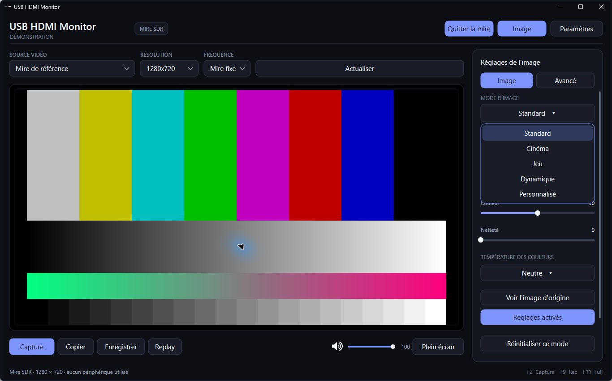

# USB HDMI Monitor

A native Windows monitor for viewing a console or another HDMI source through a USB UVC capture adapter.

[Français](./README_FR.md) · [Releases](https://github.com/Azashiin/USBHDMIMonitor/releases) · [Changelog](./CHANGELOG.md) · [License](./LICENSE.txt)

## Public preview 1.52.1 — build 1054

This preview adds a dark interface and **TV-style picture settings**. A Windows installer is available for testing. All 32 native checks and release checks pass; physical HDMI capture, hardware audio and USB reconnection still require testing with capture adapters.

**[Download installer 1.52.1](https://github.com/Azashiin/USBHDMIMonitor/releases/download/v1.52.1/USBHDMIMonitor-Setup-v1.52.1.exe)** · [Preview notes and files](https://github.com/Azashiin/USBHDMIMonitor/releases/tag/v1.52.1)

The previous stable release remains available: [1.51.0 installer](https://github.com/Azashiin/USBHDMIMonitor/releases/download/v1.51.0/USBHDMIMonitor-Setup-v1.51.0.exe).

## Picture controls

- **Standard, Cinema, Game, Dynamic and Custom** modes.
- **Brightness, contrast, color and sharpness** on a 0–100 scale.
- **Warm / Neutral / Cool** color temperature.
- Independent settings and reset for each mode.
- Original-picture comparison.
- Gamma, tint, RGB white balance and optional ICC management under **Advanced**.

These controls adjust the video picture in the app. Game is a visual preset and does not change capture latency. The display pipeline is 8-bit SDR. Picture adjustments and ICC apply to the preview and screenshots; recordings and replays retain source colors.

## Quick start

1. Run `USBHDMIMonitor-Setup-v1.52.1.exe` and follow the setup wizard.
2. Launch **USB HDMI Monitor** from the Start menu and select the capture device, resolution and frame rate. The app may open the selected device automatically.
3. Without an adapter, use the **Demo pattern** Start menu shortcut or the demo button in the app. The pattern does not open a capture or audio device.
4. Open **Picture** to adjust the image, or **Settings** for screenshots, audio, recordings and shortcuts.

Setup supports English/French, shortcuts, updates and uninstall. Updates preserve preferences. Guides are available in this repository; validation results and SHA-256 checksums accompany the release. Screenshots above show the French localization.

## Features

- HDMI preview and fullscreen viewing with GPU scaling.
- Audio monitoring when Windows exposes a matching device.
- PNG/JPEG screenshots, clipboard copy and visual save feedback.
- Manual recording and Instant Replay in MP4.
- Configurable shortcuts, tray integration and Windows startup options.
- Logs and diagnostic export from Settings.

## Requirements

Windows 10 or 11 **x64**. For live HDMI, use a USB UVC capture adapter recognized by Windows. Compatibility, available formats and audio depend on the adapter, drivers, USB connection and HDMI source.

Default shortcuts: **F2** screenshot, **Ctrl+C** copy, **F9** record, **F3** replay, **F10** settings, **F11** fullscreen, **Esc** exit fullscreen, **M** mute. Picture-mode and temperature menus also support arrow keys and Enter.

## Testing and feedback

Follow the [hardware test guide](./TEST_GUIDE_EN.md). The [French picture/ICC guide](./docs/PICTURE_SETTINGS_FR.md) covers advanced options. A software pattern does not replace measured display calibration.

When filing an [issue](https://github.com/Azashiin/USBHDMIMonitor/issues), include the app version, adapter model, HDMI source, resolution/frame rate, Windows version and steps to reproduce the problem.

## Public repository

This repository distributes binaries, documentation, screenshots and release notes. Application source code is maintained separately in a private repository. See [LICENSE.txt](./LICENSE.txt) for distribution terms.

Earlier stable-release HDMI screenshots remain in [media/screenshots](./media/screenshots).
