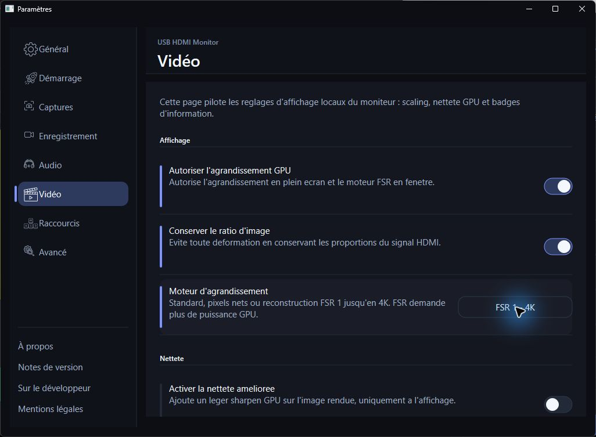
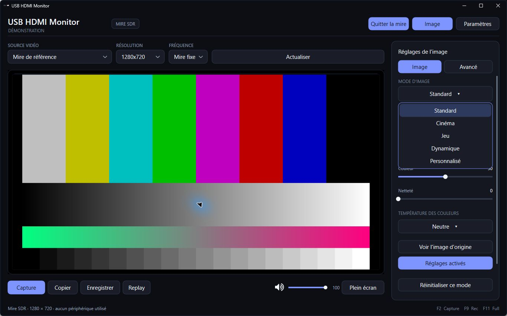

# USB HDMI Monitor

Un moniteur Windows natif pour afficher une console ou une autre source HDMI à travers un boîtier de capture USB UVC.

[English](./README.md) · [Releases](https://github.com/Azashiin/USBHDMIMonitor/releases) · [Historique](./CHANGELOG_FR.md) · [Licence](./LICENSE.txt)

## Préversion publique 1.53.0 — build 1056

Cette préversion ajoute un moteur d'agrandissement spatial **FidelityFX FSR 1**, avec reconstruction EASU et netteté adaptative RCAS, pour afficher une entrée 1080p jusqu'en 4K. Il s'active dans Paramètres > Vidéo > Moteur d'agrandissement. Le mode standard reste le réglage par défaut ; le coût GPU et le délai réel restent à vérifier sur le boîtier du testeur.

**[Télécharger l'installateur 1.53.0](https://github.com/Azashiin/USBHDMIMonitor/releases/download/v1.53.0/USBHDMIMonitor-Setup-v1.53.0.exe)** · [Notes et fichiers de la préversion](https://github.com/Azashiin/USBHDMIMonitor/releases/tag/v1.53.0)

La version stable précédente reste disponible : [installateur 1.51.0](https://github.com/Azashiin/USBHDMIMonitor/releases/download/v1.51.0/USBHDMIMonitor-Setup-v1.51.0.exe).

## Agrandissement jusqu’en 4K

Dans **Paramètres > Vidéo**, laissez **Autoriser l’agrandissement GPU** activé et choisissez **FSR 1 - 4K** dans **Moteur d’agrandissement**. Le moteur spatial Direct3D 11 reconstruit les contours avec EASU puis applique la netteté adaptative RCAS. Il fonctionne en fenêtre et en plein écran, à la taille réelle de l’aperçu, jusqu’à 3840 × 2160.

Le mode Douce reste le réglage par défaut. FSR ajoute du travail GPU et ne peut pas retrouver tous les détails d’une source 4K native. Les performances, la fluidité et le délai manette-écran restent à valider avec le boîtier du testeur et sa RTX 4060. Les captures et les vidéos gardent la résolution d’entrée. Consultez le [guide FSR](./docs/UPSCALING_FR.md).

## Réglages d'image

- Modes **Standard, Cinéma, Jeu, Dynamique et Personnalisé**.
- **Luminosité, contraste, couleur et netteté** de 0 à 100.
- Température **Chaud / Neutre / Froid**.
- Préférences et remise à zéro indépendantes pour chaque mode.
- Comparaison avec l'image d'origine.
- Gamma, teinte, balance Rouge/Vert/Bleu et gestion ICC facultative dans **Avancé**.

Ces réglages modifient l'image vidéo dans l'application. Le mode Jeu est un préréglage visuel ; il ne change pas la latence du boîtier. La chaîne d'affichage est SDR 8 bits. Les réglages d'image et l'ICC s'appliquent à l'aperçu et aux captures d'image ; les vidéos et les replays conservent les couleurs de la source.

## Démarrage rapide

1. Lancez l'installateur `USBHDMIMonitor-Setup-v1.53.0.exe` et suivez l'assistant.
2. Lancez **USB HDMI Monitor** depuis le menu Démarrer, puis choisissez le boîtier, la résolution et la fréquence. L'application peut ouvrir automatiquement la source sélectionnée.
3. Sans boîtier, utilisez le raccourci **Mire de demonstration** du menu Démarrer ou **Mire démo** dans l'application : la mire n'ouvre aucun périphérique de capture ou audio.
4. Ouvrez **Image** pour régler le rendu, ou **Paramètres** pour les captures, l'audio, les enregistrements et les raccourcis.

L'installateur propose le français et l'anglais, les raccourcis et la désinstallation. Les mises à jour conservent les préférences. Les guides sont accessibles dans ce dépôt ; les résultats des contrôles et les sommes SHA-256 accompagnent la préversion.

## Fonctions

- Aperçu HDMI et plein écran avec mise à l'échelle GPU.
- Audio lorsque Windows expose un périphérique correspondant au boîtier.
- Captures PNG/JPEG, copie de l'image et retours visuels.
- Enregistrements manuels et Instant Replay en MP4.
- Raccourcis configurables, zone de notification et options de lancement Windows.
- Journaux et export de diagnostic depuis les paramètres.

## Configuration

Windows 10 ou 11 **x64**. Pour une vraie source HDMI : boîtier USB UVC reconnu par Windows. La compatibilité, les formats et l'audio dépendent du boîtier, de ses pilotes, de la liaison USB et de la source HDMI.

Raccourcis par défaut : **F2** capture, **Ctrl+C** copie, **F9** enregistrement, **F3** replay, **F10** paramètres, **F11** plein écran, **Échap** retour en fenêtre, **M** muet. Les listes de modes et de températures se commandent aussi avec les flèches et Entrée.

## Tests et retours

Suivez le [guide de test matériel](./TEST_GUIDE_FR.md). Pour les réglages avancés, consultez le [guide Image et ICC](./docs/PICTURE_SETTINGS_FR.md). Une mire logicielle ne remplace pas une calibration mesurée.

Pour signaler un problème, indiquez la version, le modèle du boîtier, la source HDMI, la résolution/fréquence, la version de Windows et les étapes de reproduction dans les [issues](https://github.com/Azashiin/USBHDMIMonitor/issues).

## Dépôt public

Ce dépôt distribue les binaires, la documentation, les captures et les notes de version. Le code source est maintenu séparément dans un dépôt privé. Voir [LICENSE.txt](./LICENSE.txt) pour les conditions de distribution.

Les captures HDMI de la version stable précédente restent disponibles dans [media/screenshots](./media/screenshots).
